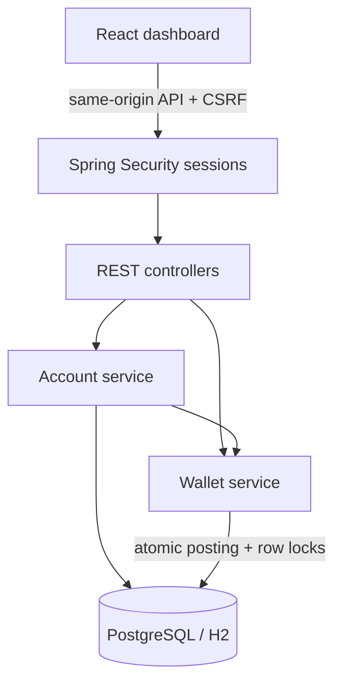

# FinCore — Money, in focus.

A runnable Java + React banking simulation, built for a backend/full-stack portfolio. All balances and payments are virtual INR. This first version implements the wallet-transfer vertical slice with transaction correctness, authentication, a real API-connected dashboard, and automated tests.

## Features

- Register and sign in; BCrypt password hashing, cookie sessions, CSRF protection, logout, and a 30-minute idle timeout.
- Every account receives ₹50,000 of simulated opening funds from a treasury wallet.
- Transfers by registered recipient email, with review and confirmation, insufficient-funds checks, and a ₹10,00,000 per-transfer limit.
- Atomic source/target balance updates and paired ledger entries, ordered database row locks, idempotent retries, and audit events.
- Transaction receipts show both ledger entries, available only to the sender and recipient.
- Paginated transaction history, per-page search and direction filters, CSV export of the visible view, and spending by category.
- Responsive React dashboard, demo accounts, account details, loading states, and errors.
- Flyway schema migrations, PostgreSQL Docker setup, H2 local development, and GitHub Actions CI.

## Fastest way to try it

Requires Java 17 or newer. From this extracted folder:

```sh
java -jar release/fincore-1.0.0.jar
```

Open **http://localhost:8080** and click **Explore the demo**. This bundled JAR includes the dashboard and a local H2 database, so no Maven, Node, or Docker installation is needed to try it. The database is created under `data/` in the directory where you run the command. Keep that folder private. Stop with Ctrl+C.

## Run with Docker (PostgreSQL)

Install Docker Desktop with Compose. Extract this folder, then open a terminal in it:

```sh
cp .env.example .env
```

On Windows PowerShell, use `Copy-Item .env.example .env` instead. Edit `.env` and choose your own `DB_PASSWORD`. Then run:

```sh
docker compose up --build
```

Open **http://localhost:3000**. The first build downloads dependencies and can take several minutes. Click **Explore the demo**, or create an account. PostgreSQL data persists in a named Docker volume. The database and backend are accessible only inside the Compose network; the dashboard binds to localhost.

Stop with `docker compose down`. This retains the data. Removing the volume deletes your local demo data.

### Demo credentials

| Account | Email | Password |
| --- | --- | --- |
| Kartikeya | demo@fincore.dev | FinCoreDemo!2026 |
| Maya Shah | maya@fincore.dev | FinCoreDemo!2026 |
| Arjun Mehta | arjun@fincore.dev | FinCoreDemo!2026 |

Try sending ₹125.50 to `maya@fincore.dev`. Click a transaction's recipient name to inspect its receipt. Seeded users and transactions are created only for a fresh database when `DEMO_SEED=true`.

## Run without Docker

Requires **Java 17+** (Java 21 recommended), **Maven 3.9+**, and **Node 22.12+** or Node 24. Two terminals:

```sh
cd backend
mvn spring-boot:run
```

```sh
cd frontend
npm ci
npm run dev
```

Open **http://localhost:5173**. Vite proxies `/api` to port 8080. Without DB environment variables, the backend creates an H2 file database in `backend/data/`. Do not share that data folder: it includes account records and password hashes.

The `release/` folder includes a self-contained JAR with the built dashboard. To regenerate it after changes, run `python scripts/build_release.py` from the project root with Maven and Node installed. A plain `mvn package` from a clean checkout builds the API; the release script also bundles frontend assets. Docker uses the separate frontend container and nginx proxy.

## Tests and builds

```sh
cd backend
mvn test
mvn package
# Requires Docker; explicitly runs the real PostgreSQL integration test:
mvn -Dtest=PostgresLedgerIT test
```

```sh
cd frontend
npm ci
npm run build
```

The default test suite exercises balances, conservation of funds, paired entries, payload conflicts, concurrent duplicate requests, concurrent overspending, opposite-direction transfers, forced database-write rollback, login, logout, CSRF, API validation, and receipt access controls. `PostgresLedgerIT` uses Testcontainers and runs separately in CI on an Ubuntu runner with Docker.

A standard-library HTTP smoke script is in `scripts/smoke.py`; run `python scripts/smoke.py` with the demo backend running. It moves ₹1 in virtual funds between the seeded accounts and verifies the live API. See `docs/VERIFICATION.md` for what was actually tested during creation.

## Architecture



The application is a small monolith. Spring JDBC makes database locks and SQL explicit; no ORM magic hides the transfer mechanism. React never chooses a sender wallet—the server derives it from the authenticated account. No client-side balance is authoritative.

The session cookie is HttpOnly; CSRF tokens are fetched from `/api/csrf` and attached to state-changing calls. A login rotates the session and CSRF token. Financial amounts become integer paise using `BigDecimal`, avoiding floating-point arithmetic on the backend.

## Project structure

```text
backend/             Spring Boot API, migration, and tests
frontend/            React app, styles, API client, nginx configuration
docs/                Architecture, API, verification, and development roadmap
scripts/             Live HTTP smoke check and release builder
release/             Built JAR and frontend assets
compose.yml          PostgreSQL + backend + frontend
.github/workflows/   Backend tests, PostgreSQL integration test, frontend build
```

## Scope and next milestones

This is a functioning portfolio MVP, not production banking software. It does not connect to banks, cards, UPI, or payment gateways. JWT, Redis, AI models, admin controls, refunds, password reset, MFA, and scheduled payments are not implemented. Audit rows are internal records, not a tamper-proof compliance log.

Before any public launch: disable shared demo credentials, add rate limits and account recovery, use HTTPS and secure cookies, persist sessions if deploying multiple backend replicas, use secret management, and verify PostgreSQL concurrency and migrations on the deployment database. The current deployment files are for local development; no live deployment is included.

See `docs/ROADMAP.md` for the next stages and `docs/ARCHITECTURE.md` for interview talking points.
